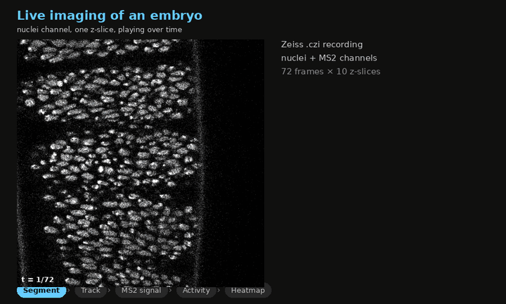

# MS2

Turns live-imaging recordings of embryos (Zeiss `.czi`, MS2 + cell channel) into per-cell
transcriptional activity, and compares it across embryos and developmental stages.



Everything runs on the lab's GPU server (`golgi`) and is used from a web browser. The lab site
has a home page with two ways in:

- **Run pipeline**: upload a CZI. The server segments and tracks every nucleus, and measures the MS2
  signal of every cell tracked for 10 frames or more.
- **Analysis**: choose the stage window, align the embryos, draw the body segments, set the
  tracking filters and the activity levels, and export figures and tables.

Contents:
- [Install the environment](#install-the-environment)
- [Run the app from the repo](#run-the-app-from-the-repo)
- [Run the web site on a server](#run-the-web-site-on-a-server)
- [Run the pipeline from the web page](#run-the-pipeline-from-the-web-page)
- [Analyse the results on the web page](#analyse-the-results-on-the-web-page)
- [Command line](#command-line)
- [When something goes wrong](#when-something-goes-wrong)

## Install the environment

On the GPU server you need conda and an NVIDIA GPU (CUDA 12.4 build of PyTorch).

```bash
git clone https://github.com/Omergottlieb33/MS2.git
cd MS2
conda env create -f environment.yml          # creates the env "ms2" and installs this repo
conda activate ms2
```

To make one environment for the whole lab, create it in the shared folder instead:

```bash
conda env create -p /zjbd/zd1/shechtmanlab/conda_envs/ms2 -f environment.yml
```

The repo is installed in editable mode, so `git pull` updates the code for everyone using
the env.

## Run the app from the repo

This runs a private copy of the app for yourself, from your checkout. The app runs on the
server and your computer reaches it through an SSH tunnel.

**With the launcher (Windows or Linux).** Do this once:

1. Let your computer log in to golgi with an SSH key:
   - Windows (PowerShell):
     ```powershell
     ssh-keygen -t ed25519      # press Enter at every question
     type $env:USERPROFILE\.ssh\id_ed25519.pub | ssh your-username@golgi "mkdir -p ~/.ssh && cat >> ~/.ssh/authorized_keys"
     ```
   - Linux:
     ```bash
     ssh-keygen -t ed25519
     ssh-copy-id your-username@golgi
     ```
2. In `launchers/ms2_settings.txt`, set `SSH_USER` to your golgi username and `PORT` to a
   number between 8700 and 8799 that nobody else uses.

Then double-click `launchers/MS2.bat` on Windows, or run `launchers/ms2.sh` on Linux. The
browser opens by itself. Keep the black window open while you work.

**By hand.** From your computer:

```bash
ssh -L 8765:localhost:8765 your-username@golgi
```

Then, in that SSH session on the server:

```bash
cd MS2 && conda activate ms2
ms2 app --data-root /zjbd/zd1/shechtmanlab --port 8765
```

Open http://localhost:8765 for the pipeline page, and http://localhost:8765/analysis for the
Analysis page.

- **Port:** use your own number, the same on both sides of `-L` and in `--port`.
- **Data root:** the folder the app may browse for CZI files and write results into.
- **Closing:** closing the app or the SSH session doesn't stop runs that have already started.

## Run the web site on a server

One always-on site serves the whole lab. Users open `http://golgi:<port>` on the lab network
or VPN, with nothing installed, and log in with their name and a shared lab password.

```bash
echo 'the-lab-password' > ~/.ms2_password && chmod 600 ~/.ms2_password
# the result folders the Analysis page always shows, one per line (# for comments)
echo /zjbd/zd1/shechtmanlab/omer/MS2/outputs/020626 > ~/ms2_analysis_folders.txt
mkdir -p ~/ms2_analysis_saves

tmux new -s ms2site
conda activate ms2 && cd ~/MS2
ms2 app --host 0.0.0.0 --port 8800 \
    --workspace /zjbd/zd1/shechtmanlab/omer/ms2_web --password-file ~/.ms2_password \
    --analysis-folders ~/ms2_analysis_folders.txt --analysis-saves ~/ms2_analysis_saves
```

Detach with `Ctrl-b d`; the site keeps running. The options:

| Option | What it does |
|---|---|
| `--workspace DIR` | each user's runs go to `DIR/<name>/<DDMMYY>/<recording>/`, the uploaded CZI inside. Users can't write outside their own folder |
| `--password-file` | the lab password. A login lasts 30 days; changing the file and restarting logs everyone out |
| `--analysis-folders FILE` | result folders listed on the Analysis page for everyone. It is read on every request, so editing it needs no restart |
| `--analysis-saves DIR` | where saved analyses are kept, shared by everyone |
| `--host 0.0.0.0` | reachable from other computers, not only from the server |

The page files are read from the checkout on every request, so a change to a page shows
after a browser refresh. A change to the Python code needs a restart: in the tmux session,
press `Ctrl-c` and run the command again. Runs already started keep going.

The password travels as plain http, so keep the site on the lab network and VPN. There is
no GPU queue: two runs on one GPU can run out of memory, and the processor list shows each
GPU's free memory. Uploads and runs are never deleted automatically.

**Only the Analysis page.** `--analysis-only FILE --password-file FILE --out-root SAVES`
serves the Analysis page alone, behind the password, over the folders listed in `FILE`.

**After a reboot.** A tmux session doesn't survive a reboot; start the site again. To restart
it automatically, run the same command as a `systemd --user` service with `Restart=on-failure`
and `KillMode=process`. This needs `loginctl enable-linger <you>` once, from an admin.

## Run the pipeline from the web page

1. Open the site and log in with your name and the lab password.
2. Click **Run pipeline**.
3. Under **CZI file**, choose the recording from your computer. It uploads to your folder on
   the server, `<workspace>/<name>/<today, DDMMYY>/<recording>/`, and the results are
   written there too.
4. **Processor:** pick the GPU with the most free memory. Leave **Advanced settings** alone
   unless you know why. *MS2 spot prominence* is how bright a spot must be to count as
   transcription.
5. Click **Start analysis**. The page switches to **Runs & results**.

A run goes through six steps, and its bar shows where it is:

| Step | What happens | Typical time |
|---|---|---|
| preprocess | splits the channels, removes the MS2 background | minutes |
| segment | finds every nucleus in 3D (GPU) | the longest step |
| track | follows each cell from frame to frame | minutes |
| unify | repairs cells that were split or merged | minutes |
| gene_expression | measures the MS2 signal of every cell tracked ≥ 10 frames | minutes to an hour |
| activity | groups cells by activity level, draws figures | minutes |

- **running** refreshes by itself.
- **finished** lists the results below the log.
- **failed**: open the log and send its last lines to the maintainer.
- **stopped** / **paused**: **Resume** continues from the first unfinished step.

Click a run for **Open viewer** (the embryo frame by frame with the detected cells),
**Tracking dashboard** (how well cells were followed) and **Download results** (a zip of the logs
and tables). You can close the browser: the run keeps going on the server. When it has finished,
the run appears on the Analysis page.

## Analyse the results on the web page

Click **Analysis** on the home page. Nothing on this page changes the run's results, so try
settings as often as you like; the page remembers your choices when you come back. Every
section redraws as soon as you change something above it.

**The recording list** (left) shows the lab's results, grouped by stage folder. It shows only
results whose MS2 was measured on every cell. **Search** filters it. **Add from ms2_web** browses
everyone's runs and adds one to the list. **Add** takes a result's path. **Refresh** finds new results.

### 1. Samples and stages: choose and align the recordings

- **Stage comparison:** several embryos at one stage. Type the **Stage**, then click each
  recording in the list to add it.
- **Single recording, several stages:** one embryo over its stages. Click the recording, add a
  stage for each further one, and name each.

For each sample:
- **Stage window:** set where the stage **starts** and **ends** with the sliders under the
  first and last frames. The **middle frame** follows the window until you move it.
- **Orientation:** align every embryo the same way with **⟲ 90° / ⟳ 90°**, the angle slider and
  **⇋ / ⇵ flip**. Everything below is drawn in this orientation.
- **brightness / contrast:** these work like ImageJ's and change the display only. **reset**
  returns to the full range.
- **Zoom:** wheel to zoom, drag to move, double-click to fit.

The first time a recording is opened it takes about half a minute while its cells are read.

### 2. Cells: tracking filters

A cell is analysed only if it passes both filters:
- **Tracked through at least …% of the window:** cells followed through less of the stage are
  left out.
- **Volume CV at most …:** cells whose segmented volume changes too much over the stage (an
  unstable segmentation) are left out.

### 3. Region and segments: draw the segments

1. Pick a segment, **2** to **5**.
2. Choose the frame (**start**, **middle** or **end**).
3. Click around the segment on the image, then press **close**. The tool moves on to the next segment.
4. Outline segments on as many of the three frames as you need.

A cell is in a segment when it lies inside that segment's outline on that frame.

- **The ROI** (white) is made for you: one outline joining the segments. A cell is analysed
  when it passes the tracking filters and lies in any segment. With no segment drawn, every
  cell passing the filters is analysed.
- **The table** beside the panel appears once segments 2–5 are all outlined. It shows the
  cells each segment will analyse, and the ROI total.
- **MS2 emitters → show:** draws, in yellow, the MS2 spots of the analysed cells on the frame
  shown. Only spots accepted by gene expression are drawn. The table then counts them per segment.
- **undo** removes the last point, **clear** removes the outline, **fit** shows the whole frame.
- **Save and load:** **save to server** keeps the window, orientation and segments in
  `ms2_web/region_and_segment/<DDMMYY>/<recording>_stage<N>.json`. **load segments from a file**
  restores them later, with their frames and orientation.
- **Box each segment** chooses what the segment's grid in section 6 is cut from: the analysed
  cells inside it, or the outline.

### 4. Activity clustering: choose the activity levels

- **Noise floor:** a cell fires on a frame when its MS2 signal is above it.
- **Blip height above the floor:** a cell whose highest signal never rises this far above the
  floor is a *short burst / noise*. At 0 AU there are none.
- **The two rate cuts** split the rest into weakly, moderate and highly active. **Automatic**
  places them with KMeans over all samples together; moving a cut sets it by hand.

The table gives each sample's cells per level. **⬇ table (CSV)** downloads it with the settings
used; **⬇ per-cell table (CSV)** gives one row per analysed cell (level, rate, peak, position,
segments). The heatmap shows every cell above silent, with time as the position in each
sample's window (0 = start, 1 = end).

### 5. Level composition and spatial map

- **Level composition:** the share of each sample's cells in every level.
- **Active cells over time:** one line per sample over the stage window (0–1).
  - **active at the frame:** the % of tracked cells firing at each point of the window.
  - **onset:** the % of cells that have fired by then.
  - **⬇ table (CSV)** downloads the curves.
- **Aligned spatial map:** every analysed cell in its level's colour, at its average position or on
  the start, middle or end frame.
- **Middle frame by cluster:** each sample's middle frame with the analysed cells outlined in
  their cluster's colour.

Every figure has **⬇ image**.

### 6. Segment histograms

Each segment is stretched onto one square: centre (0, 0), right-upper corner (1, 1),
left-lower (−1, −1). The same segment of every sample then lies on the same square.
- **Value:** the share of cells firing, the mean intensity per cell, or the share in each cluster.
- **Bins:** a grid, or about N cells per bin. Prefer about 4–6 cells per bin: a bin of 1–2 cells
  can only read 0, ½ or 1.
- **Time:** the whole window, or 0%, 10%, … 100% of it.

Hatched bins hold no cells. The table under the maps gives how alike each pair of samples' maps
are (Pearson r).

### 7. Save results

Give the analysis a name and click **Make results zip**. It takes a few minutes, then the zip
downloads by itself.
- **Top of the zip:** the segment histograms, the heatmap, the level composition and the aligned spatial map.
- **`work_product/`:** the settings, the outlines, `cells.csv`, `metrics.csv`, `stats.csv` and the
  other figures.

Saved analyses are listed below the button; **load** reopens one exactly as it was.

The p-values in `stats.csv` compare **cells**, not embryos. A small p-value means the samples
differ, not that the stages or conditions differ. To claim that, you need several embryos per group.

## Command line

Everything is one command, `ms2`; `ms2 <command> -h` lists each command's options.

```bash
ms2 app                                  # the browser app (what the launchers start)
ms2 run <rec>.czi --out <root> [--device cuda:0] [--stop-after STEP]
ms2 compare experiment.json              # several recordings, then their comparison
ms2 view --image ... --masks-dir ... --tracklets ...   # segmentation / tracking viewer
ms2 dashboard --tracklets ... --masks-dir ...          # tracking-quality dashboard
```

`ms2 run` writes each step into `<root>/<rec>/` and marks it done, so a rerun resumes where the
last one stopped. Recordings are `.czi` time series `(T, C, Z, Y, X)`: channel 0 is MS2 and
channel 1 is the cell channel used for segmentation and tracking.

Tests are plain scripts: `for f in tests/test_*.py; do python $f; done`.

## When something goes wrong

| What you see | What to do |
|---|---|
| The site doesn't open | You are outside the Technion network: connect to the VPN. Or the site isn't running: start it again ([Run the web site on a server](#run-the-web-site-on-a-server)). |
| A new page feature doesn't work, but the page shows it | The server runs older Python code: restart it. |
| `Permission denied (publickey,password)` | The SSH key isn't set up; repeat step 1 of [Run the app from the repo](#run-the-app-from-the-repo). |
| `Could not resolve hostname golgi` | Use `HOST=132.68.106.73` in the launcher settings. |
| `port … is in use` | Someone else uses your port number; pick another. |
| A run **failed** at *segment* with "out of memory" | The GPU was busy: pick another GPU and press **Resume**. |
| A recording is grey on the Analysis page | Its tracks, masks or cell image weren't found; the list says which. |

## License

MIT, see [LICENSE](LICENSE). To cite: Gottlieb, O. *MS2: infrastructure for cell and
fluorescence analysis* (2025), https://github.com/Omergottlieb33/MS2.
